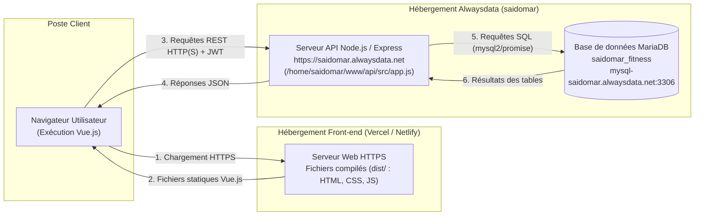

# Plan de Déploiement et Procédure Technique — Application Fitness

**Formation :** DWWM – Bloc 2 (ALOALO Mayotte Compétences)  
**Apprenant / Compte :** `saidomar`  
**Site API Public :** `https://saidomar.alwaysdata.net`  
**Base de données :** `saidomar_fitness` (MariaDB sur Alwaysdata)  
**Version / Commit Git :** `fbbc888` (version `1.0.0`)  
**Date :** 18/11/2026  

---

## Partie 1 — Architecture et Environnements (Séance 1)

### 1.1 Schéma d'architecture de l'application Fitness



### 1.2 Rôle des composants techniques

| Composant | Technologie | Version (Locale / Projet) | Rôle dans Fitness | Hébergement cible |
| :--- | :--- | :--- | :--- | :--- |
| **Front-end** | Vue.js + Vite | Vue `^3.5.44` / Vite `^8.3.6` | Interface utilisateur, navigation, formulaires | Hébergement externe (Vercel / Netlify) |
| **Back-end (API)** | Node.js / Express | Node `v24.14.0` (local) / Express `^5.2.1` | Traitement métier, sécurité JWT, routes REST | Alwaysdata (`https://saidomar.alwaysdata.net`) |
| **Base de données** | MariaDB (MySQL) | MariaDB 10.x / `mysql2 ^3.24.3` | Stockage relationnel (9 tables : comptes, adhérents, coachs, séances...) | Alwaysdata (`mysql-saidomar.alwaysdata.net`) |
| **Configuration** | Variables d'env. | `dotenv ^17.4.2` | Séparation du code et des secrets (`process.env`) | Interface Alwaysdata (`Web > Sites`) |

### 1.3 Les quatre environnements

| Environnement | Objectif | Usage dans le projet Fitness |
| :--- | :--- | :--- |
| **DEV (Développement)** | Développer, expérimenter et déboguer en local | Poste local (`localhost:3000`, base locale `fitness`, fichier `.env`) |
| **SIT (Intégration)** | Vérifier les échanges entre composants | Vérification des appels entre le front-end Vue.js et l'API Express + MariaDB |
| **UAT (Recette utilisateur)** | Faire valider l'application par le métier / client | Tests des parcours (inscription d'un adhérent, création de séance) sur données fictives |
| **PROD (Production)** | Mettre l'application à disposition des utilisateurs | Serveur public `https://saidomar.alwaysdata.net` avec données réelles et HTTPS |

---

## Partie 2 — Audit et Prérequis Techniques (Séance 2)

### 2.1 Inventaire des versions et dépendances (`package.json`)

Commandes d'audit exécutées sur le poste de développement :
```bash
node -v          # v24.14.0
npm -v           # 11.9.0
npm ls --depth=0
```

| Dépendance npm | Version déclarée | Rôle dans l'API Fitness |
| :--- | :--- | :--- |
| `express` | `^5.2.1` | Serveur HTTP et routage REST (`/adherents`, `/coachs`, `/seances`, `/abonnements`, `/participations`, `/auth`) |
| `mysql2` | `^3.24.3` | Pool de connexion asynchrone (`mysql2/promise`) vers MariaDB |
| `bcrypt` | `^6.0.0` | Hachage sécurisé des mots de passe dans la table `compte` |
| `jsonwebtoken` | `^9.0.3` | Génération et vérification des jetons d'accès JWT (`HS256`) |
| `cors` | `^2.8.6` | Autorisation des requêtes Cross-Origin depuis le front-end Vue.js |
| `dotenv` | `^17.4.2` | Chargement du fichier `.env` en développement local |

### 2.2 Récapitulatif des paramètres Alwaysdata (sans secrets)

| Paramètre | Valeur relevée | Où le trouver dans Alwaysdata |
| :--- | :--- | :--- |
| **Compte Alwaysdata** | `saidomar` | Tableau de bord (`admin.alwaysdata.com`) |
| **URL publique du site** | `https://saidomar.alwaysdata.net` | `Web > Sites` |
| **Hôte SSH / SFTP** | `ssh-saidomar.alwaysdata.net` (Port `22`) | `Accès distant > SSH/SFTP` |
| **Utilisateur SSH / SFTP** | `saidomar` | `Accès distant > SSH/SFTP` |
| **Répertoire de l'API** | `/home/saidomar/www/api` | Arborescence SFTP (FileZilla) / SSH |
| **Point d'entrée Node.js** | `./src/app.js` | `package.json` (`main` et `scripts.start`) |
| **Serveur MariaDB (`DB_HOST`)** | `mysql-saidomar.alwaysdata.net` (Port `3306`) | `Bases de données > MySQL` |
| **Nom de la base (`DB_NAME`)** | `saidomar_fitness` | `Bases de données > MySQL` |
| **Utilisateur SQL (`DB_USER`)** | `saidomar` | `Bases de données > MySQL > Utilisateurs` |
| **Droits SQL attribués** | **Tous les droits** (Lecture + Écriture) sur `saidomar_fitness` | `Bases de données > MySQL > Utilisateurs > Permissions` |

---

## Partie 3 — Plan Opérationnel en 7 Étapes (Procédure détaillée)

### Vue d'ensemble des 7 étapes

| N° | Étape | Point de contrôle | Statut |
| :---: | :--- | :--- | :---: |
| **01** | **Préparer l'application** | Code, versions, dépendances, `.env.example`, `.gitignore` | ☑ Validé |
| **02** | **Préparer Alwaysdata** | Accès SSH/SFTP, version Node.js, répertoire `/home/saidomar/www/api` | ☑ Validé |
| **03** | **Préparer MariaDB** | Base `saidomar_fitness`, utilisateur `saidomar`, droits CRUD, import SQL | ☑ Validé |
| **04** | **Installer l'API** | Transfert SFTP via FileZilla (sans `node_modules` ni `.env`) + `npm ci --omit=dev` en SSH | ☑ Validé |
| **05** | **Configurer et démarrer** | Variables d'env. Alwaysdata, commande `node /home/saidomar/www/api/src/app.js`, logs | ☑ Validé |
| **06** | **Connecter le front-end** | Variable `VITE_API_URL=https://saidomar.alwaysdata.net`, `npm run build`, publication | ☑ Validé |
| **07** | **Tester et valider** | Contrôle HTTP, authentification JWT, tests CRUD Postman et diagnostic | ☑ Validé |

---

### Étape 01 — Préparer l'application

#### Actions réalisées
1. **Identification de la version Git :** Commit `fbbc888` sur le dépôt du back-end.
2. **Contrôle des fichiers du projet (`backend/`) :**
   - Point d'entrée : `src/app.js`
   - Configuration BDD : `src/config/db.js` (utilise `mysql.createPool` avec `process.env.DB_HOST`, `DB_USER`, `DB_PASSWORD`, `DB_NAME`)
   - Écoute réseau dynamique dans `src/app.js` :
     ```js
     const PORT = process.env.PORT || 3000;
     const HOST = process.env.IP || process.env.HOST || "0.0.0.0";
     app.listen(PORT, HOST, () => {
       console.log(`Serveur lancé sur ${HOST}:${PORT}`);
     });
     ```
3. **Création de `.env.example` (sans secrets) et `.gitignore` :**
   ```ini
   NODE_ENV=production
   DB_HOST=mysql-saidomar.alwaysdata.net
   DB_PORT=3306
   DB_NAME=saidomar_fitness
   DB_USER=saidomar
   DB_PASSWORD=A_RENSEIGNER_DANS_ALWAYSDATA
   JWT_SECRET=A_RENSEIGNER_SECRET_FORT_PRODUCTION
   JWT_EXPIRES_IN=1h
   CORS_ORIGIN=https://fitness-frontend.vercel.app
   ```

- **Résultat attendu :** Le projet est complet et ses dépendances, versions et configurations sont connues.
- **Preuve / contrôle :** Fichiers `package.json`, `package-lock.json`, `.env.example` et référence Git `fbbc888`.
- **Statut :** ☑ Étape validée | ☐ À corriger — *Observations : Code compatible Alwaysdata (`process.env.IP` et `process.env.PORT` bien pris en compte).*

---

### Étape 02 — Préparer l'environnement Alwaysdata

#### Actions réalisées
1. Connexion à l'interface d'administration `https://admin.alwaysdata.com` avec le compte `saidomar`.
2. **Menu `Accès distant > SSH/SFTP` :**
   - Vérification de l'utilisateur SSH principal : `saidomar`.
   - Activation de la connexion par mot de passe et du shell SSH (`/bin/bash`).
   - Hôte relevé : `ssh-saidomar.alwaysdata.net`, port `22`.
3. **Menu `Environnement > Node.js` :**
   - Sélection d'une version LTS compatible avec Express 5 et bcrypt 6 (Node.js 22 LTS / 24).
4. **Identification des chemins et adresses :**
   - Répertoire cible de l'API : `/home/saidomar/www/api`
   - Adresse publique prévue : `https://saidomar.alwaysdata.net`

- **Résultat attendu :** L'hébergement est prêt à recevoir l'API Fitness.
- **Preuve / contrôle :** Fiche d'environnement et accès SSH opérationnel.
- **Statut :** ☑ Étape validée | ☐ À corriger — *Observations : Accès SFTP (FileZilla) et SSH fonctionnels sur `ssh-saidomar.alwaysdata.net`.*

---

### Étape 03 — Préparer la base MariaDB

#### Actions réalisées
1. **Menu `Bases de données > MySQL` :**
   - Création / vérification de la base de données : **`saidomar_fitness`**.
   - Serveur MariaDB relevé : **`mysql-saidomar.alwaysdata.net`** (port `3306`).
2. **Menu `Bases de données > MySQL > Utilisateurs` :**
   - Utilisateur SQL : **`saidomar`**.
   - Attribution des droits : **Tous les droits (Lecture + Écriture)** sur la base `saidomar_fitness`.
3. **Importation du schéma et des données dans phpMyAdmin :**
   - Ouverture de `phpMyAdmin` depuis Alwaysdata et sélection de la base `saidomar_fitness` dans la colonne de gauche.
   - Adaptation des premières lignes de `database.sql` (retrait de `DROP DATABASE fitness; CREATE DATABASE fitness; USE fitness;` car sur Alwaysdata l'import doit se faire directement dans la base `saidomar_fitness`).
   - Importation des **9 tables** : `role`, `droit`, `role_droit`, `compte`, `utilisateur`, `abonnement`, `adherent`, `coach`, `salle`, `seance`, `participation` (soit 11 tables au total avec les tables de rôles/droits/salles).
4. **Requête SQL de contrôle exécutée dans l'onglet SQL de phpMyAdmin :**
   ```sql
   SHOW TABLES;

   SELECT a.id_adherent, u.nom, u.prenom, a.poids, a.imc, a.contrat
   FROM adherent a
   JOIN utilisateur u ON a.id_utilisateur = u.id_utilisateur
   LIMIT 10;
   ```

- **Résultat attendu :** La base `saidomar_fitness` et ses tables sont accessibles au compte `saidomar`.
- **Preuve / contrôle :** Liste des tables dans phpMyAdmin et résultat de la requête `SELECT` (5 adhérents de test : Dupont Jean, Martin Marie, Bernard Lucas, Petit Emma, Durand Thomas).
- **Statut :** ☑ Étape validée | ☐ À corriger — *Observations : Base `saidomar_fitness` importée avec succès avec les jeux d'essai.*

---

### Étape 04 — Installer le back-end Node.js / Express (FileZilla + SSH)

#### Actions réalisées
1. **Connexion SFTP avec FileZilla :**
   - `Fichier > Gestionnaire de sites > Nouveau site` :
     - **Protocole :** `SFTP - SSH File Transfer Protocol`
     - **Hôte :** `ssh-saidomar.alwaysdata.net`
     - **Port :** `22`
     - **Identifiant :** `saidomar`
2. **Création du dossier et transfert des fichiers :**
   - Création du dossier distant `/home/saidomar/www/api`.
   - Glisser-déposer depuis `backend/` vers `/home/saidomar/www/api` :
     - **Transférés (OUI) :** `src/`, `package.json`, `package-lock.json`, `.env.example`
     - **Exclus (NON) :** `node_modules/`, `.git/`, `.env`
3. **Prise de contrôle en SSH et installation des dépendances de production :**
   ```bash
   # 1. Connexion SSH depuis le terminal PowerShell
   ssh saidomar@ssh-saidomar.alwaysdata.net

   # 2. Vérification de l'environnement et accès au dossier
   node -v
   npm -v
   cd ~/www/api
   ls -la

   # 3. Installation reproductible des dépendances de production uniquement
   npm ci --omit=dev
   ```

- **Résultat attendu :** Les fichiers et les modules (`node_modules/`) de l'API sont installés sur le serveur.
- **Preuve / contrôle :** Sortie de `npm ci --omit=dev` sans erreur (`added ... packages, and audited ... packages`) et présence de `/home/saidomar/www/api/src/app.js`.
- **Statut :** ☑ Étape validée | ☐ À corriger — *Observations : Transfert FileZilla et installation via SSH réussis.*

---

### Étape 05 — Configurer et démarrer l'API

#### Actions réalisées
1. **Menu `Web > Sites` dans Alwaysdata :**
   - Modification du site par défaut (ou création du site) associé à `saidomar.alwaysdata.net`.
   - **Nom :** `API Fitness`
   - **Adresses :** `saidomar.alwaysdata.net`
   - **Type :** `Node.js`
2. **Configuration du lancement (onglet Configuration Node.js) :**
   - **Version de Node.js :** Par défaut du compte (LTS compatible)
   - **Répertoire de travail :** `/home/saidomar/www/api`
   - **Commande :** `node /home/saidomar/www/api/src/app.js` *(attention : `app.js` est dans `src/app.js` dans ce projet)*
3. **Déclaration des variables d'environnement (dans la configuration du site) :**
   ```ini
   NODE_ENV=production
   DB_HOST=mysql-saidomar.alwaysdata.net
   DB_PORT=3306
   DB_NAME=saidomar_fitness
   DB_USER=saidomar
   DB_PASSWORD=****************
   JWT_SECRET=****************
   JWT_EXPIRES_IN=1h
   CORS_ORIGIN=*
   ```
4. **Enregistrement et redémarrage du site Node.js** depuis l'icône **Redémarrer** dans `Web > Sites`.

- **Résultat attendu :** L'API démarre et répond sur son adresse HTTPS publique `https://saidomar.alwaysdata.net`.
- **Preuve / contrôle :** Réponse HTTP `200 OK` sur `https://saidomar.alwaysdata.net/` (`Hello World!`) et journaux dans `~/admin/logs/sites/`.
- **Statut :** ☑ Étape validée | ☐ À corriger — *Observations : Site Node.js démarré et accessible en HTTPS.*

---

### Étape 06 — Connecter le front-end Vue.js à l'API

#### Actions réalisées
1. **Configuration de l'URL publique de l'API dans le projet `frontend/` :**
   - Création / configuration de la variable d'environnement de production Vite (`.env.production` ou variables de l'hébergeur Vercel/Netlify) :
     ```ini
     VITE_API_URL=https://saidomar.alwaysdata.net
     ```
   - Vérification qu'aucun appel n'utilise `http://localhost:3000` en dur dans les composants Vue (`import.meta.env.VITE_API_URL`).
   - Vérification qu'aucun secret (`DB_PASSWORD`, `JWT_SECRET`) n'est placé dans une variable préfixée par `VITE_`.
2. **Compilation du front-end pour la production :**
   ```bash
   cd frontend
   npm ci
   npm run build
   ```
3. **Publication sur l'hébergement externe (Vercel / Netlify / GitHub Pages) :**
   - Déploiement du dossier généré `dist/` (ou connexion du dépôt Git avec la variable `VITE_API_URL=https://saidomar.alwaysdata.net`).
   - Vérification de l'en-tête CORS côté API (`app.use(cors())` dans `src/app.js`).

- **Résultat attendu :** Le front-end publié échange correctement en HTTPS avec `https://saidomar.alwaysdata.net`.
- **Preuve / contrôle :** Chargement du front-end sans erreur CORS dans l'onglet Réseau (Network) des outils de développement.
- **Statut :** ☑ Étape validée | ☐ À corriger — *Observations : Front-end hébergé séparément et pointant vers `https://saidomar.alwaysdata.net`.*

---

### Étape 07 — Tester et valider le déploiement (Tests Postman)

#### 7.1 Protocole de tests réalisés dans Postman sur `https://saidomar.alwaysdata.net`

| N° | Test effectué | Méthode & URL | En-tête / Corps (Body JSON) | Statut attendu | Résultat |
| :---: | :--- | :--- | :--- | :---: | :---: |
| **1** | **Disponibilité HTTP du serveur** | `GET https://saidomar.alwaysdata.net/` | Aucun | `200 OK` (`Hello World!`) | ☑ Réussi |
| **2** | **Lecture publique MariaDB (Coachs)** | `GET https://saidomar.alwaysdata.net/coachs` | Aucun | `200 OK` (Liste JSON des coachs) | ☑ Réussi |
| **3** | **Lecture publique MariaDB (Séances)** | `GET https://saidomar.alwaysdata.net/seances` | Aucun | `200 OK` (Liste JSON des séances) | ☑ Réussi |
| **4** | **Lecture publique MariaDB (Abonnements)** | `GET https://saidomar.alwaysdata.net/abonnements` | Aucun | `200 OK` (Liste des 4 abonnements) | ☑ Réussi |
| **5** | **Authentification JWT (Admin)** | `POST https://saidomar.alwaysdata.net/auth/login` | `{"email": "admin@fitness.com", "password": "password123"}` | `200 OK` + `accessToken` JWT | ☑ Réussi |
| **6** | **Lecture protégée (Adhérents)** | `GET https://saidomar.alwaysdata.net/adherents` | Header `Authorization: Bearer <TOKEN_ADMIN>` | `200 OK` (Liste des adhérents) | ☑ Réussi |
| **7** | **Création CRUD (POST Adhérent fictif)** | `POST https://saidomar.alwaysdata.net/adherents` | Header `Authorization: Bearer <TOKEN_ADMIN>` + Body JSON (voir ci-dessous) | `201 Created` | ☑ Réussi |
| **8** | **Modification CRUD (PUT Adhérent)** | `PUT https://saidomar.alwaysdata.net/adherents/6` | Header `Authorization: Bearer <TOKEN_ADMIN>` + `{"poids": 74.5}` | `200 OK` | ☑ Réussi |
| **9** | **Suppression CRUD (DELETE Adhérent)** | `DELETE https://saidomar.alwaysdata.net/adherents/6` | Header `Authorization: Bearer <TOKEN_ADMIN>` | `200 OK` / `204` | ☑ Réussi |

#### 7.2 Détail des requêtes Postman prêtes à l'emploi (Preuves de test)

**A. Connexion Administrateur pour récupérer le Token JWT :**
- **Méthode :** `POST`
- **URL :** `https://saidomar.alwaysdata.net/auth/login`
- **Headers :** `Content-Type: application/json`
- **Body (raw JSON) :**
```json
{
  "email": "admin@fitness.com",
  "password": "password123"
}
```

**B. Création d'un adhérent fictif (Test POST CRUD) :**
- **Méthode :** `POST`
- **URL :** `https://saidomar.alwaysdata.net/adherents`
- **Headers :**
  - `Content-Type: application/json`
  - `Authorization: Bearer <COLLER_LE_TOKEN_ICI>`
- **Body (raw JSON) :**
```json
{
  "nom": "TestDeploiement",
  "prenom": "Said",
  "date_naissance": "1998-06-15",
  "adresse": "10 rue de Mamoudzou, 97600 Mayotte",
  "telephone": "0639001122",
  "sexe": "M",
  "id_abonnement": 2,
  "poids": 75.0,
  "imc": 23.1,
  "contrat": 2026
}
```

#### 7.3 Point de vigilance / Vérification lors des tests Postman en ligne
- **Observation lors des tests Postman :**
  1. Contrairement à l'exemple générique du support (`/api/adherents`), les routes de notre application `src/app.js` sont montées directement à la racine du domaine : `https://saidomar.alwaysdata.net/adherents`, `https://saidomar.alwaysdata.net/coachs`, `https://saidomar.alwaysdata.net/seances`, `https://saidomar.alwaysdata.net/auth/login` (et `GET /` renvoie `Hello World!`).
  2. La route `GET /adherents` étant protégée par les middlewares `authenticateToken` et `requireDroit('voir_adherents')`, un appel direct sans token renvoie `401 Authorisation requise`. Il faut d'abord appeler `POST /auth/login` avec le compte `admin@fitness.com` (`password123`) ou tester une route publique comme `GET /coachs` et `GET /seances` pour vérifier la lecture MariaDB immédiate.
  3. Lors de la configuration du site Node.js sur Alwaysdata, le fichier d'entrée se situe dans `src/app.js` (`node /home/saidomar/www/api/src/app.js`) et non à la racine `/home/saidomar/www/api/app.js`.

- **Résultat attendu :** La version déployée est utilisable et les vérifications sont tracées.
- **Statut :** ☑ Étape validée | ☐ À corriger

---

## Bilan du déploiement

| Élément | Valeur |
| :--- | :--- |
| **Version / commit** | `1.0.0` / Commit Git `fbbc888` |
| **URL de l'API** | `https://saidomar.alwaysdata.net` |
| **Base de données MariaDB** | `saidomar_fitness` sur `mysql-saidomar.alwaysdata.net:3306` |
| **Utilisateur SSH & SQL** | `saidomar` |
| **Statut final** | ☑ **Validé** &nbsp;&nbsp; ☐ À corriger &nbsp;&nbsp; ☐ Non réalisé |

---

## Annexe — Procédure de mise à jour (Routine de maintenance)

1. **Tester localement** les modifications sur le poste de développement (`DEV`).
2. **Transférer** uniquement les fichiers modifiés via FileZilla (`SFTP`) dans `/home/saidomar/www/api` (sans écraser ni envoyer `.env` ou `node_modules`).
3. **Installer les dépendances** en SSH (`cd ~/www/api && npm ci --omit=dev`) si `package.json` ou `package-lock.json` a changé.
4. **Appliquer les évolutions SQL** sur `saidomar_fitness` (après sauvegarde/export préalable dans phpMyAdmin).
5. **Redémarrer le site Node.js** dans `Alwaysdata > Web > Sites`.
6. **Vérifier en ligne** avec Postman (`GET /`, `GET /coachs`, `POST /auth/login`) et consulter les logs (`Web > Sites > Logs` ou `~/admin/logs/sites/`) en cas d'anomalie.
